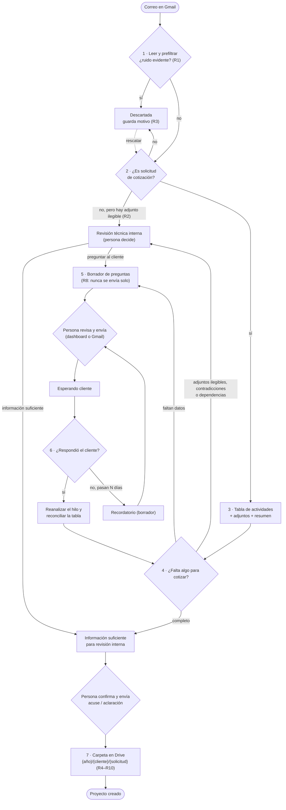

# Flujo de la Fase 1 y su estándar

Alcance: leer correos → identificar solicitudes → tabla de actividades → detectar datos faltantes → pedirlos → esperar la respuesta y cerrar la tabla → crear la carpeta en Drive. **No se cotiza** (sin precios ni presupuesto): eso es la fase 2.

Las reglas de criterio viven en `skills/anka-cotizaciones-correo/references/reglas_operativas.md` (R1–R10) y se cambian con `ESTANDAR_CAMBIOS.md`. Este documento define **el flujo y qué debe cumplir cada paso**; si algo choca con las reglas, mandan las reglas.

## 1. Diagrama de flujo

## 2. Estados

| Estado (`QuoteStatus`) | Etiqueta en el dashboard | Lo deja… |
|---|---|---|
| `ignored` | Descartada | prefiltro o análisis; se puede rescatar |
| `review` | Revisión técnica interna | adjuntos ilegibles, contradicciones, sin actividades |
| `review_pending` | Requiere aclaraciones | faltan datos; hay borrador de preguntas |
| `draft_created` | Borrador preparado | borrador guardado en Gmail |
| `sending` / `waiting` | Enviando / Esperando cliente | el envío de las preguntas |
| `ready_review` | Información suficiente | alcance completo, pendiente de revisión interna |
| `response_sent` | Respuesta enviada | envío sin carpeta pendiente |
| `ready` | Proyecto creado | carpeta de Drive creada |
| `missing` | Hilo no disponible | el hilo ya no existe en Gmail |

## 3. Estándar de cada paso

Cada paso debe cumplir lo mismo en los tres modos (`local`, `api`, `chatgpt_work`). Columna «Evidencia»: lo que debe quedar registrado para poder reconstruir qué pasó.

| # | Paso | Entrada | Salida | Terminado cuando | Evidencia | Quién ejecuta |
|---|---|---|---|---|---|---|
| 1 | Leer | hilo de Gmail | mensajes del cliente + adjuntos | se leyó todo el hilo o se registró por qué no | log del ciclo / latido del puente | Python (local/api) · Work + puente |
| 2 | Identificar | mensajes | `is_quote_request` + motivo | decisión con motivo guardado (R1–R3) | motivo del descarte | modelo |
| 3 | Tabla | mensajes + adjuntos | actividades (actividad, servicio, ubicación, magnitud, unidad, entregable, plazo, fuente, estado) | cada fila con fuente; lo no explícito = «no indicado» | evento `analysis` | modelo |
| 4 | Faltantes | tabla | lista crítica/recomendable, contradicciones, dependencias | solo se pregunta lo que bloquea la cotización | preguntas en el caso | modelo + `required_fields` |
| 5 | Pedir datos | preguntas | borrador en el mismo hilo | una persona lo revisa y lo envía (R8) | evento `sent` (origen: dashboard/Gmail) | persona |
| 6 | Cerrar tabla | respuesta del cliente | tabla reconciliada | no quedan preguntas críticas y una persona lo da por cerrado | evento `received` + `analysis` | modelo + persona |
| 7 | Carpeta | caso con información suficiente | carpeta del proyecto con documentos y hoja de actividades | cliente confirmado, año válido, sin duplicados (R4–R10) | `folder_id` + evento | Python (dashboard), nunca Work |

**Principios transversales** (ya vigentes salvo donde se indica):
- Nada sale al cliente sin una persona (R8). Work nunca crea carpetas (R9–R10).
- No se inventa ningún dato: lo ausente es «no indicado».
- Trazabilidad: cada hecho queda con hora y origen (dashboard, Gmail o Work) en la sección *Seguimiento*. **Pendiente:** hoy solo se anotan análisis, envíos y respuestas; los cambios hechos por una persona (decidir revisión técnica, editar la tabla, crear la carpeta) aún no dejan evento.
- Lo que la persona fijó a mano (cliente, clasificación, tabla editada) no lo pisa un reanálisis.

## 4. Paso 6 a fondo (parcial)

### Qué hace hoy
- **local / api:** cada ciclo vuelve a leer los hilos en `waiting`; ante un correo nuevo ejecuta de nuevo el análisis sobre **todo el hilo** y reemplaza el análisis anterior. Si una persona editó la tabla a mano, esa edición se conserva y lo nuevo del modelo se guarda aparte (`pending_model_activities`).
- **chatgpt_work:** la skill (paso 7) pide reconciliar con la tabla anterior; la tarea de Work crea o actualiza el borrador con el JSON y el puente lo importa. Desde el seguimiento nuevo, el dashboard anota la respuesta y avisa con «El cliente respondió».

### Brechas
| # | Brecha | Efecto |
|---|---|---|
| G1 | El caso sigue en «Esperando cliente» aunque el cliente ya respondió. | No se ve qué casos exigen acción. |
| G2 | En Work nada garantiza que la respuesta se reanalice: si la tarea no corre, el caso queda detenido sin aviso. | Casos que se quedan sin avanzar. |
| G3 | La reconciliación reemplaza la tabla sin mostrar qué cambió. | No se puede auditar qué aportó la respuesta. |
| G4 | `pending_model_activities` se guarda pero **ninguna pantalla lo muestra**. | Las propuestas del modelo sobre una tabla editada a mano se pierden de vista. |
| G5 | «Tabla terminada» no es un acto explícito: pasa a «Información suficiente» cuando el modelo ya no encuentra faltantes. | Se cierra sin confirmación humana y sin criterio escrito. |
| G6 | Si el cliente no contesta, nada lo señala ni propone insistir. | Solicitudes olvidadas. |
| G7 | Solo se sigue el mismo hilo (más el mismo remitente para el cliente). Una respuesta en un correo nuevo no se enlaza. | Respuestas que no llegan al caso. |

### Mejoras propuestas (ordenadas)
**Prioridad 1: visibilidad, con datos que ya existen.**
1. **Respuesta pendiente (G1+G2).** Marca derivada, sin estado nuevo: hay un `received` posterior al último `sent`/`analysis`. El caso muestra «Cliente respondió · sin analizar hace X». Si pasa de un umbral (p. ej. 30 min en Work), se resalta como alerta. Es el aviso de que la tarea no corrió.
2. **Mostrar las propuestas del modelo (G4).** En el caso, comparar la tabla editada con `pending_model_activities` y permitir aceptar o descartar fila a fila.

**Prioridad 2: control del cierre.**
3. **Diferencias entre versiones (G3).** Guardar la versión anterior de la tabla y mostrar filas nuevas, modificadas y resueltas, y qué preguntas quedaron contestadas.
4. **Confirmar alcance (G5).** Criterio escrito (regla R11): tabla terminada = sin faltantes críticos + sin contradicciones/dependencias + **confirmación de una persona** con un botón. Se cambia primero `reglas_operativas.md`, luego Python y skill, según `ESTANDAR_CAMBIOS.md`.

**Prioridad 3: seguimiento.**
5. **Recordatorio (G6).** Tras N días sin respuesta (propuesta: 3 hábiles) marcar el caso y proponer un borrador de recordatorio. Sigue siendo borrador (R8).
6. **Respuestas fuera del hilo (G7).** Sugerir «posible respuesta» por remitente y asunto parecido, siempre con vinculación manual.

**Transversal.** Registrar un evento por cada cambio hecho por una persona, para que el seguimiento cuente la historia completa venga de donde venga.

## 5. Código de la oferta (T / T&E) y control de cambios

**Ciclo del código.** Antes de aceptar el proyecto no hay código: el cliente puede escribir libremente (dudas, aclaraciones). Al aceptar el proyecto una persona asigna la **T** (`T` + año de 2 cifras + consecutivo de 3, p. ej. `T26145`) y se prepara el correo «proyecto recibido». Cuando el cliente aprueba la oferta, la T pasa a **T&E** con el mismo número. `T26145`, `T-26145` y `T&E26145` se reconocen como el mismo código.

**El contacto registrado** es quien escribió primero.

**Mensajes posteriores a la T.** Una persona decide si el mensaje pide un cambio; si lo pide, corresponden estos correos (siempre borradores que se revisan, R8):

| Quién escribe | ¿Cita la T? | Correos |
|---|---|---|
| Contacto registrado | Sí | «Cambio recibido» al contacto |
| Contacto registrado | No | Pedirle la T |
| Otra persona | Sí | «Cambio recibido» a quien escribió + aviso al contacto registrado |
| Otra persona | No | Pedirle la T (sin revelarla) + aviso al contacto registrado |

El texto enviado a quien no es el contacto registrado **nunca incluye el código**. Solo se puede escribir a personas que ya participan en el caso.

**Evidencia.**
- Cada hecho guarda fecha, autor (persona y empresa), un extracto y el enlace al correo; está encadenado con una huella del hecho anterior, así que alterar o quitar uno se detecta.
- Cada mensaje posterior a la T se guarda completo (`evidence/<hilo>/<mensaje>.eml`); esas copias viajan en la copia de seguridad diaria a Drive.
- Eliminar un caso **no borra su historial**: queda en el *Archivo*, con su acta.
- El **acta de cambios** (`/acta`) lista quién pidió qué, cuándo, con qué código, a quién se avisó y la verificación de integridad; se imprime o se guarda como PDF.
- Las acciones de las personas (editar la tabla, decidir la revisión técnica, asignar la T, confirmar un cambio, enviar correos) también quedan registradas.

**Regla R11 (versión 5 de las reglas).** Con T asignada, la tabla solo se actualiza con un mensaje del contacto registrado que cite el código; lo demás queda como propuesta pendiente. Se aplica igual en los tres modos: Work informa `requested_by_email`, `requested_by_name` y `cited_codes`, y el dashboard valida; el piloto de Python aplica la misma función. **Pendiente:** que Work lea los otros hilos.
