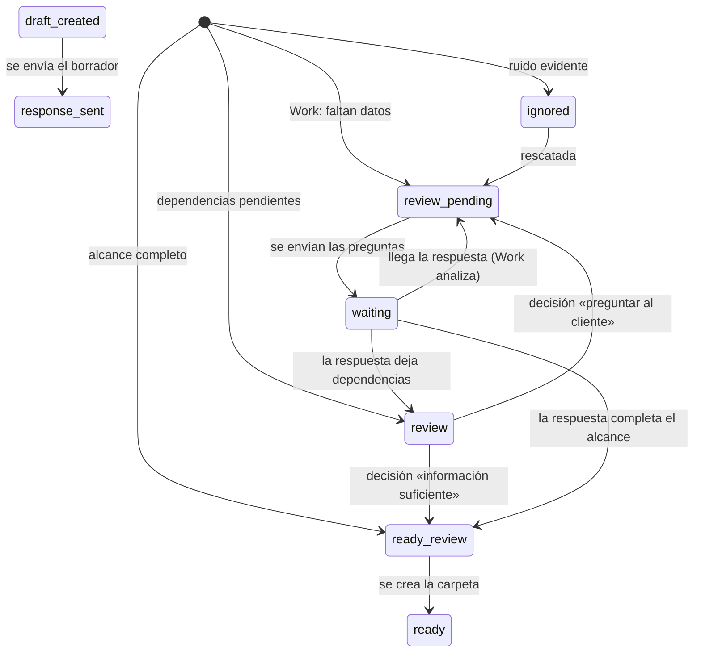

# Flujo y estados

El diagrama del flujo de la Fase 1 y el estándar de cada paso están en [`../docs/FLUJO_FASE1.md`](../docs/FLUJO_FASE1.md).
Aquí se fija el **ciclo de vida de un caso**, que es lo que el código debe respetar. Requisito: **T-01**.

## Estados (`QuoteStatus`)
| Estado | Etiqueta en el dashboard | Significa |
|---|---|---|
| `review_pending` | Correo por revisar | Faltan datos; el correo con las preguntas está redactado y falta enviarlo |
| `review` | Revisión técnica interna | Una persona debe decidir (dependencias, contradicciones, adjuntos ilegibles) |
| `ready_review` | Información suficiente | Alcance completo; listo para emitir la T |
| `waiting` | Esperando al cliente | Se le enviaron preguntas |
| `draft_created` | Correo por revisar | Hay un borrador de respuesta guardado en Gmail |
| `response_sent` | Respuesta enviada | Se envió una respuesta |
| `ready` | Proyecto creado | Carpeta de Drive creada |
| `sending` | Enviando | Envío en curso o interrumpido |
| `missing` | Hilo no disponible | El hilo ya no existe en Gmail |
| `ignored` | Descartada | No es solicitud comercial (con motivo guardado) |

A estos estados se suma la **etapa de la oferta**: sin código → T (cotizando) → T&E (aprobada), independiente del
estado del correo. Lo que la persona ve en la lista es la **etapa o la acción pendiente** (`U-04`), no el estado
interno.

**Previsto (U-73, D-138): «Pendiente de análisis de Work» no es un estado.** Es un indicador de la lista, derivado de que el hilo tiene correos entrantes registrados sin un análisis de Work que los cubra; el caso preliminar vive en `review` y no se añade ningún estado ni transición.

## Transiciones
La tabla completa y ejecutable es [`transiciones.json`](transiciones.json). Resumen:

## Reglas de las transiciones
1. **Un borrador de Work nunca retrocede un caso con carpeta creada ni con un envío en curso.**
2. **Volver a analizar el mismo mensaje no mueve** un caso con respuesta enviada; **un mensaje nuevo del cliente sí**.
3. **Con dependencias o contradicciones pendientes el caso pasa a `review`**, sea cual sea el estado que dijo Work.
4. **Enviar las preguntas desde el dashboard deja el caso en `waiting`**; enviar con información suficiente no cambia
   el estado (la carpeta sigue pendiente).
5. **Un correo enviado desde Gmail mueve el caso igual que si se enviara desde el dashboard** (`review_pending` y
   `sending` → `waiting`; `draft_created` → `response_sent`).
6. Cualquier cambio a esta tabla empieza en `transiciones.json`; `tests/test_transiciones.py` ejecuta todas las filas.
